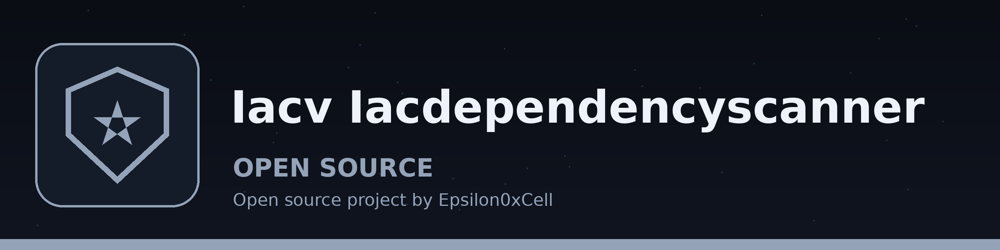

# iacv-IacDependencyScanner
Lists the external dependencies named in an IaC file, and, when asked, validates the file against a JSON Schema policy. The dependency check walks values at any depth, including strings inside lists, and matches image references on docker.io, ghcr.io, quay.io, ECR hosts (amazonaws.com, with or without a containers segment), gcr.io, and azurecr.io, Docker Hub shorthand forms such as nginx:latest and sentinel/app:1.0, git and registry module source strings, and script URLs ending in .sh, .ps1, or .py, including URLs carrying a query string. It is a listing only: this tool does not check any dependency against a vulnerability database, does no advisory lookup, and gives no risk assessment or severity scoring, and dependency findings leave the exit code at 0. The security check reports every schema violation it finds, not only the first, and exits 1 on any violation; a policy file that is not a valid schema means no validation ran and also exits 1. A run with neither check flag checks nothing and exits 2. Input files are YAML or JSON only; Terraform and CloudFormation files are not parsed unless they are in one of those forms (a Terraform .tf.json file loads as JSON). Dependencies: `jsonschema` and `PyYAML`, listed in requirements.txt.

## Install
`git clone https://github.com/ShadowStrikeHQ/iacv-iacdependencyscanner`

## Usage
`python3 main.py manifest.yaml --dependency-check`
`python3 main.py manifest.yaml --security-check --policy-file policy.json`

## Parameters
- `-h`: Show help message and exit
- `iac_file`: Path to the IaC file (YAML or JSON)
- `--dependency-check`: List external dependencies (image references, module sources, script URLs)
- `--security-check`: Validate the file against the JSON Schema policy given with --policy-file
- `--policy-file`: Path to the security policy file (a JSON Schema, in YAML or JSON). Required for security checks.
- `--log-level`: Set the logging level (default: INFO)

## License
Copyright (c) ShadowStrikeHQ
